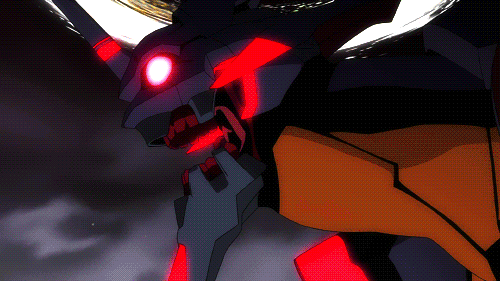

<!--  -->

<!-- 

  
  

 -->

---

### 🧬 About Me

<ul>
  <li>🎯 Frontend Developer</li>
  <li>📌 Building clean web apps with smooth UI/UX</li>
  <li>🏢 Part of <b>Universitas Buana Perjuangan Karawang</b></li>
  <li>💻 Main stack: <b>PHP</b>, <b>TypeScript</b>, <b>JavaScript</b></li>
</ul>

---

### 🌐 Let's Connect

  
  
  

---

### 👾 Tech Stack

  <a href="https://skillicons.dev">
     
    
  </a>

---

### `> featured_projects`

<table>
<tr>
<td width="33%" valign="top">

#### 🧩 Kuesify
*Interactive AI Quiz Platform*

- **Role:** UI/UX & Frontend (API Helper)
- **Stack:** `Laravel` `Vue` `TS` `Tailwind`
- **Link:** [Repo Kuesify](https://github.com/RafiArizu/Kuesify)

</td>
<td width="33%" valign="top">

#### 📑 ZETA E-Procurement
*Tender & Vendor Management*

- **Role:** UI/UX & Frontend Ionic (API Helper)
- **Stack:** `Laravel` `Ionic` `TS` `MySQL`
- **Link:** [Repo e-tender](https://github.com/RafiArizu/e-tender)

</td>
<td width="33%" valign="top">

#### 💰 KeuanganKu
*Student Finance & Monitoring*

- **Role:** UI/UX & Dashboard UI (Helper)
- **Stack:** `PHP` `Tailwind` `MySQL` `Chart.js`
- **Link:** [Repo KeuanganKu](https://github.com/RafiArizu/KeunganKu)

</td>
</tr>
</table>

---

<!-- ### `> github_stats` -->

<!-- 

  
  

 -->

---

### `> connect`

- Portfolio: https://rafi-arizu-portofolio.vercel.app/
- GitHub: https://github.com/RafiArizu
- Email: rafiariz95@gmail.com

<!-- ponytail: asset badge eksternal via cdn; ganti static svg lokal jika butuh zero-dependency -->
